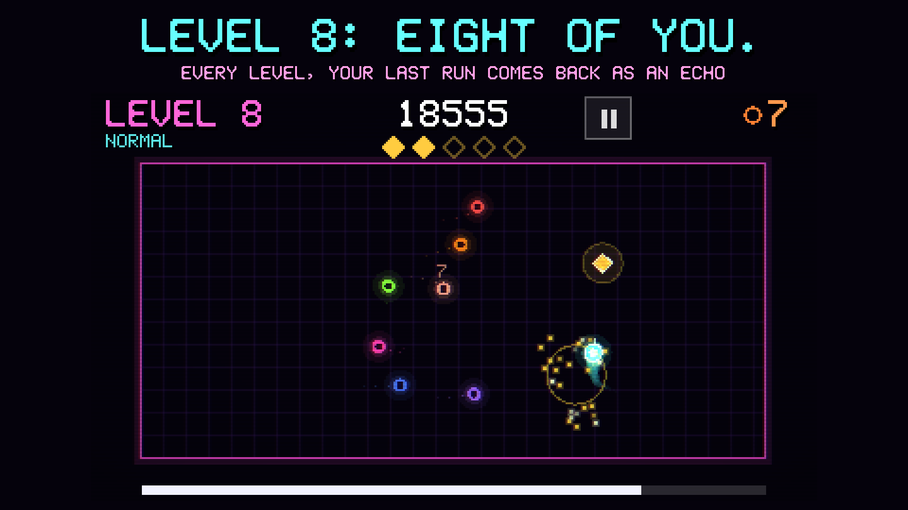

# ECHOES

**Every level, your past runs come back as echoes. Don't touch them.**



## Download

**[⬇ Download ECHOES for Android (APK)](https://github.com/roshangupta00750/echoes/releases/latest/download/echoes.apk)**: one click and the file downloads.

- Every version, with release notes: **[Releases](https://github.com/roshangupta00750/echoes/releases)**
- Coming soon on **F-Droid**.
- Needs Android 7.0 or newer (64-bit / arm64, which is almost every phone from the last few years).

## Install the APK

### On your phone (easiest)
1. On the phone, open the **Download** link above.
2. Tap the downloaded **echoes.apk**, in the notification or in your *Files / Downloads* app.
3. Android asks to allow installs from this source the first time. Tap **Settings** → turn on **Allow from this source** → go back.
4. Tap **Install**, then **Open**.

If you already have an older test build of ECHOES that was signed differently, Android says *"App not installed"*.
Uninstall the old one first.

### From a computer, over USB
First, on the phone: **Settings → About phone → tap "Build number" 7 times**, then
**Settings → Developer options → turn on USB debugging**. Plug the phone in and tap **Allow** when it asks.

**Mac** (Terminal):
```bash
brew install android-platform-tools        # needs Homebrew: https://brew.sh
cd ~/Downloads
adb devices                                # your phone should be listed as "device"
adb install -r echoes.apk
```

**Windows** (PowerShell):
```powershell
winget install Google.PlatformTools
# close and reopen PowerShell, then:
cd $HOME\Downloads
adb devices
adb install -r echoes.apk
```

**Linux** (Debian / Ubuntu; on Fedora use `sudo dnf install android-tools`):
```bash
sudo apt install adb
cd ~/Downloads
adb devices
adb install -r echoes.apk
```

## Features
- **Modes:** Normal, Hard and Extreme. In Extreme the newest echo hunts you and shards drift if you wait. Each mode opens by clearing level 6 of the one before.
- **Goals:** a Daily Run with the same start for everyone and a daily streak, 14 missions, bronze/silver/gold medals at levels 5/10/15, and unlockable trails and echo colours.
- **Fair deaths:** safe spawns, rings on resting echoes, path previews at 3-2-1, and a replay of the past self that caught you.
- **LAN multiplayer** on the same Wi-Fi or hotspot: everyone's runs become echoes for everyone. Get caught and you come back as a **zombie** that hunts the living. Last human standing wins.
- **Controls:** touch (a floating stick), tilt, or tilt to steer and touch to go, with a 3-step tilt calibration.
- **Sharing:** a 1080×1080 score card that draws every one of your past runs, shared through Android's share menu.
- No ads, no accounts, no analytics, no tracking.

## Run it from the source code (for players, forks and contributors)

### 1. Get the code
Fork the repository on GitHub (the **Fork** button, top right) if you want your own copy to change, then:
```bash
git clone https://github.com/roshangupta00750/echoes.git     # or your fork's URL
cd echoes
```
No git? Use **Code → Download ZIP** on the GitHub page and unzip it.

### 2. Install Godot 4.7.2
ECHOES is made with **Godot 4.7.2 (standard, not .NET)**. Download it from
<https://github.com/godotengine/godot/releases/tag/4.7.2-stable>:

| System  | File to download | How to start it |
|---|---|---|
| Mac     | `Godot_v4.7.2-stable_macos.universal.zip` | unzip, move **Godot.app** to Applications, open it |
| Windows | `Godot_v4.7.2-stable_win64.exe.zip` | unzip, run `Godot_v4.7.2-stable_win64.exe` |
| Linux   | `Godot_v4.7.2-stable_linux.x86_64.zip` | unzip, `chmod +x Godot_v4.7.2-stable_linux.x86_64`, run it |

### 3. Play it on your computer
In Godot: **Import** → choose the `echoes` folder (its `project.godot`) → **Import & Edit** → press **F5** (▶ Play).
Use the mouse or WASD / arrow keys to move, Enter to start, Esc to pause.

Or from a terminal, inside the `echoes` folder:
```bash
# Mac
/Applications/Godot.app/Contents/MacOS/Godot --path .
# Windows (PowerShell)
& "C:\path\to\Godot_v4.7.2-stable_win64.exe" --path .
# Linux
~/Godot_v4.7.2-stable_linux.x86_64 --path .
```

### 4. Build your own APK
You need, once:
- **Godot's export templates:** in Godot, **Editor → Manage Export Templates → Download and Install**.
- **Java 17** and the **Android SDK**. The simplest way on every system is to install [Android Studio](https://developer.android.com/studio), open **More Actions → SDK Manager**, and install *Android SDK Platform 36*, *Build-Tools 36* and *Platform-Tools*. Or, without Android Studio:
  - Mac: `brew install openjdk@17 && brew install --cask android-commandlinetools && sdkmanager "platform-tools" "platforms;android-36" "build-tools;36.1.0"`
  - Windows: `winget install EclipseAdoptium.Temurin.17.JDK`, then [command-line tools](https://developer.android.com/studio#command-line-tools-only) and the same `sdkmanager` line
  - Linux: `sudo apt install openjdk-17-jdk`, then [command-line tools](https://developer.android.com/studio#command-line-tools-only) and the same `sdkmanager` line
- In Godot: **Editor → Editor Settings → Export → Android**: set **Java SDK Path** and **Android SDK Path**. Godot normally creates a debug signing key for you (it uses Java's `keytool`).

Then **Project → Export… → Android → Export Project** (untick *Export With Debug* for a release). Or from a terminal:
```bash
# Mac
/Applications/Godot.app/Contents/MacOS/Godot --headless --path . --export-debug Android build/echoes.apk
# Windows (PowerShell; the _console.exe prints progress)
& "C:\path\to\Godot_v4.7.2-stable_win64_console.exe" --headless --path . --export-debug Android build\echoes.apk
# Linux
~/Godot_v4.7.2-stable_linux.x86_64 --headless --path . --export-debug Android build/echoes.apk
```
The APK lands in `build/echoes.apk`. Install it with the `adb install -r` commands above.

For a **release** build signed with your own key, set these three environment variables and use `--export-release` instead of `--export-debug`:
`GODOT_ANDROID_KEYSTORE_RELEASE_PATH`, `GODOT_ANDROID_KEYSTORE_RELEASE_USER`, `GODOT_ANDROID_KEYSTORE_RELEASE_PASSWORD`.

### Test flags
User arguments go after `--`, for example `Godot --path . -- --autoplay --mode=hard`:
- `--autoplay [--mode=normal|hard|extreme]`: a bot plays and prints its result
- `--host --players=N` / `--join=IP`: LAN bots
- `--shot=PATH --shot_at=SECONDS --quit_after_shot`: take a screenshot

## Project layout
- `scripts/game.gd`: the rules, the echoes, zombies and drawing
- `scripts/main.gd`: menus, HUD, flow, saves, daily/missions/medals, controls, sharing, the LAN lobby
- `scripts/net.gd`: ENet host/join and LAN discovery (UDP broadcast)
- `scripts/art.gd`, `scripts/sound.gd`: pixel text and audio playback
- `shaders/crt.gdshader`: the CRT look
- `assets/`: fonts, icon layers, audio
- `tools/`: scripts that generate the audio, the icon and the store images
- `fastlane/`: the store listing (texts and screenshots) that F-Droid reads
- `fdroid/`: the F-Droid build recipe (see `fdroid/README.md`)

## License
- Code: [Apache License 2.0](LICENSE) (see also [NOTICE](NOTICE))
- Art and audio (everything in `assets/`, and the store images): [CC BY-SA 4.0](LICENSE-ASSETS.md)
- Built with [Godot Engine](https://godotengine.org) (MIT)

## Privacy
ECHOES has no ads, no accounts, no analytics and no tracking. The network permissions are used only for
LAN games on your own Wi-Fi or hotspot. Your progress stays on your phone.

## Author
Roshan Kumar Gupta
